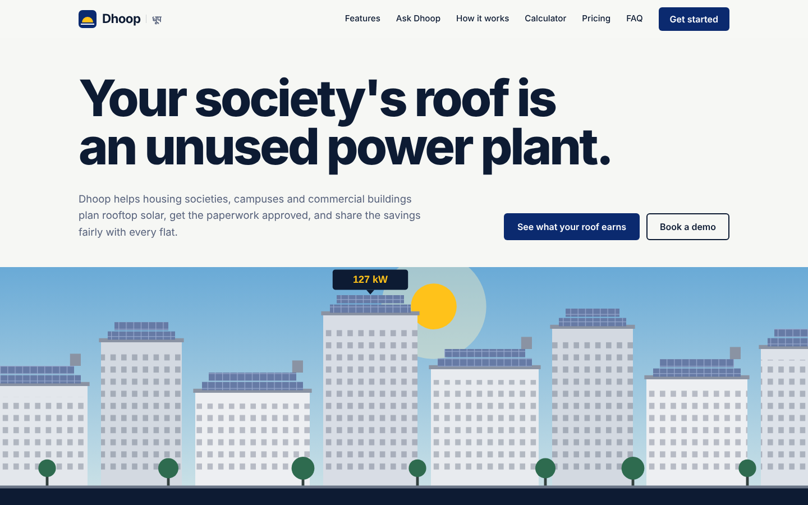
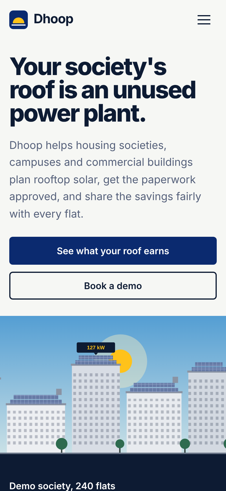
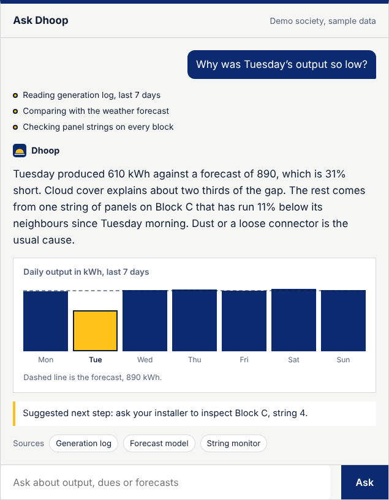

# Dhoop: rooftop solar for housing societies

A responsive SaaS landing page, built for the Sankar Group front-end internship assignment.

**Live site:** https://sriyamalhar.github.io/dhoop/

**The idea.** Dhoop (Hindi for "sunlight") is a concept workspace for housing societies, campuses and commercial buildings that want rooftop solar. It handles sizing, paperwork, generation tracking and fair billing across flats. It sits where Sankar Group works: clean energy (solar), fintech (UPI settlement of savings) and AI (an assistant that answers questions about the roof, plus output forecasts and fault alerts).

All numbers, names and contact details are sample content. The AI assistant is a scripted demo on made-up data, and the demo form does not send anything.

## Screenshots

**Desktop**



**Mobile and the Ask Dhoop assistant**

<table>
  <tr>
    <td align="center"><br>Mobile (390px)</td>
    <td align="center"><br>Ask Dhoop assistant</td>
  </tr>
</table>

## Run it locally

No build step and no dependencies. The whole site is one file.

1. Download or clone the repo and open `index.html` in any modern browser, or
2. Serve the folder: `python3 -m http.server 8000` and visit http://localhost:8000

Google Fonts load from the internet. Offline, the page falls back to system fonts and still works.

## Technologies

- HTML5 (semantic landmarks, `details` for the FAQ, an SVG icon sprite)
- CSS3 (custom properties, Grid, Flexbox, `clamp()` fluid type, no framework)
- Vanilla JavaScript, no libraries
- Fonts: Bricolage Grotesque and Public Sans (Google Fonts)

CSS and JavaScript are inside `index.html` (a `<style>` block and a `<script>` block) so the site deploys as a single file.

## What each requirement maps to

| Requirement | Where |
| --- | --- |
| Navigation bar with Get started | Sticky header, mobile menu, active link follows scroll |
| Hero with headline, CTA, visual | Headline, two CTAs, and an SVG skyline you drag through the day |
| Three or more features | Six feature rows with icons and sample readings |
| About / How it works | "How a society uses Dhoop", a four-stage timeline |
| Two or more pricing plans | Three plans with a monthly/yearly toggle |
| Contact / demo form and footer | Validated demo form with a success message; footer |
| Buttons do something | Every button scrolls to a section or toggles state; plan buttons pre-select the plan in the form |
| Form validation and success message | Inline errors on blur and submit, focus moves to the first error, success panel |
| Responsive | Checked at 1440px and 390px with no horizontal overflow |

Extras: an "Ask Dhoop" AI assistant demo (four questions, charts and cited sources), a savings calculator with a break-even chart, a skip link, visible keyboard focus and `prefers-reduced-motion` support.

## Files

```
index.html          the whole site
README.md
SUBMISSION.md       short design explanation
1-desktop.png       screenshots
2-mobile.png
3-ask-dhoop-assistant.png
```
